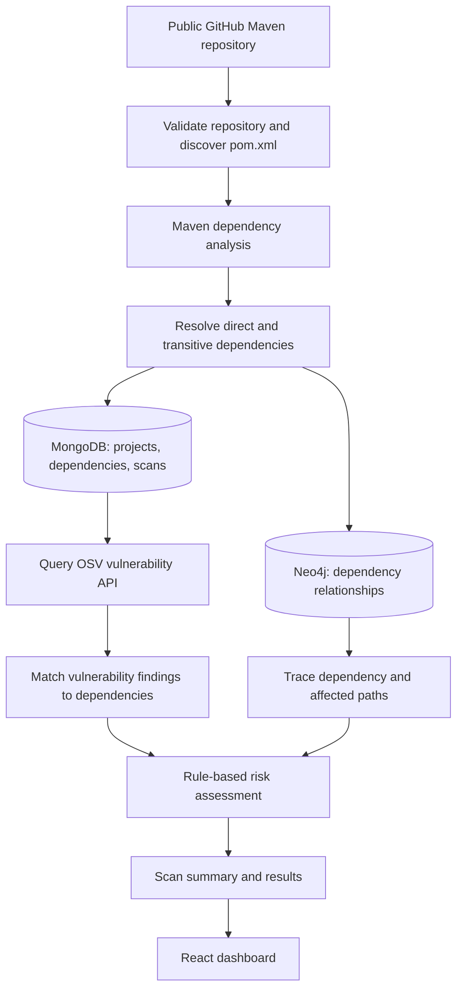
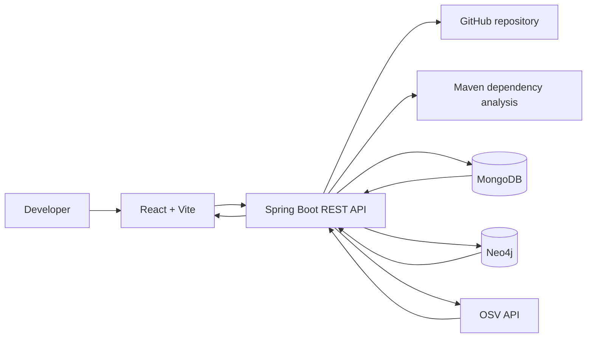

<div align="center">

# OpenChain Sentinel

### See the chain. Understand the risk. Secure the software.

**A software supply-chain dependency intelligence platform for analysing Maven dependencies, identifying known vulnerabilities, tracing affected paths, and prioritising risk.**


</div>

---

## Table of Contents
- [Overview](#overview)
- [Problem Statement](#problem-statement)
- [Objectives](#objectives)
- [Key Features](#key-features)
- [How It Works](#how-it-works)
- [Architecture](#architecture)
- [Technology Stack](#technology-stack)
- [Project Structure](#project-structure)
- [Prerequisites](#prerequisites)
- [Local Setup](#local-setup)
- [Configuration](#configuration)
- [API Overview](#api-overview)
- [Security and Limitations](#security-and-limitations)
- [Current Status](#current-status)
- [Roadmap](#roadmap)
- [Contributing](#contributing)
- [License](#license)

## Overview

Modern applications rely on direct and transitive third-party dependencies. A vulnerability in a deeply nested package can affect an application even when the developer did not add that package directly.

**OpenChain Sentinel** is a developer-oriented project for analysing public GitHub repositories that use Maven. It combines document-oriented storage with graph-based relationship analysis to help developers understand which dependencies a repository uses, which packages are associated with known vulnerabilities, how vulnerable packages are reached through the dependency tree, and where further investigation may be needed.

The project combines **MongoDB** for descriptive and scan-related data with **Neo4j** for dependency relationships. Known vulnerability information is queried from the **OSV (Open Source Vulnerabilities) API**. A rule-based risk assessment layer uses available scan and vulnerability context to help prioritise findings.

> **Project scope:** OpenChain Sentinel currently focuses on public GitHub repositories using Maven (`pom.xml`). It is an academic/engineering project under active development, not a production security certification service.

## Problem Statement

Dependency lists become difficult to reason about as projects grow. Direct dependencies may bring in many transitive packages, and a vulnerability report by itself may not explain how an affected package enters the application or which dependency paths lead to it.

OpenChain Sentinel explores a combined approach:
1. Store package, scan, and vulnerability information as structured documents.
2. Represent package-to-package relationships as a graph.
3. Use vulnerability intelligence to identify packages with known advisories.
4. Trace dependency paths to make findings easier to investigate.
5. Apply transparent, rule-based prioritisation to support remediation decisions.

The goal is not to replace established vulnerability scanners. It is to provide a focused view of dependency relationships, affected paths, and contextual risk in one workflow.

## Objectives

- Retrieve and analyse Maven dependency information from a public GitHub repository.
- Resolve direct and transitive dependencies and retain their relationship context.
- Store scan and dependency metadata in MongoDB.
- Model dependency relationships in Neo4j.
- Query OSV for known vulnerability information.
- Identify vulnerable dependencies and trace affected paths where graph data permits.
- Generate a rule-based risk assessment and scan summary.
- Present project and scan information through a web interface.
- Establish JWT-based authentication and project-level ownership controls.

## Key Features

### Repository and dependency analysis
- Accept a public GitHub repository as the scan source.
- Discover Maven `pom.xml` files.
- Analyse the Maven dependency tree.
- Capture direct and transitive dependency information and available path/depth context.

### Vulnerability intelligence
- Query the OSV API for known vulnerability information.
- Associate returned findings with analysed dependencies.
- Present findings for further investigation.

### Graph-based dependency exploration
- Store dependency relationships in Neo4j.
- Support dependency graph retrieval and affected-path analysis.
- Help explain how a vulnerable transitive package may be connected to a project.

### Contextual risk assessment
- Apply a rule-based risk assessment using available vulnerability and dependency context.
- Produce prioritisation information and scan summaries.
- The current risk engine is **rule-based**, not an AI/ML prediction model.

### Web dashboard
The React interface includes views for dashboard, projects and project details, scan history and scan results, vulnerability intelligence, dependency graph, risk analysis, and settings/account information.

The interface and authentication experience are still being developed; see [Current Status](#current-status).

## How It Works



## Architecture

OpenChain Sentinel is organised into three main layers:

1. **Frontend:** React, Vite, React Router and Axios provide the browser interface and communicate with the backend API.
2. **Backend:** Java 21 and Spring Boot coordinate repository analysis, scan orchestration, persistence, vulnerability lookup, graph operations and risk assessment.
3. **Data and intelligence:** MongoDB stores descriptive records, Neo4j stores dependency relationships, and OSV supplies known vulnerability data.



### Why two databases?

| Component | Responsibility | Why it fits |
|---|---|---|
| **MongoDB** | Project records, dependency metadata, scan results, vulnerability details and related documents | These records contain descriptive fields and can vary in structure. |
| **Neo4j** | Dependency nodes and relationships, graph traversal and path analysis | Dependency chains are naturally represented as connected entities. |
| **OSV API** | Known vulnerability intelligence | Supplies vulnerability records that can be matched against analysed packages. |

A simple mental model:
- **MongoDB:** What information do we have?
- **Neo4j:** How are the packages connected?
- **OSV:** What known vulnerability information is available?
- **Risk engine:** Which findings should be investigated first, based on implemented rules?

## Technology Stack

| Area | Technologies |
|---|---|
| Language | Java 21 |
| Backend | Spring Boot, REST APIs, Maven |
| Frontend | React, Vite, JavaScript |
| Routing | React Router |
| HTTP client | Axios |
| UI icons | Lucide React |
| Dependency graph UI | `@xyflow/react` |
| Document database | MongoDB |
| Graph database | Neo4j |
| Vulnerability intelligence | OSV API |
| Authentication foundation | Spring Security, JWT |
| Source control | Git and GitHub |

## Project Structure

```text
openChain-Sentinel/
├── backend/       # Spring Boot REST API and analysis services
├── frontend/      # React + Vite web application
└── README.md
```

The exact internal package and component structure may evolve during development.

## Prerequisites

- Git
- Java JDK 21
- Maven (or Maven Wrapper, if present)
- Node.js and npm
- MongoDB (local or hosted)
- Neo4j (local or hosted)
- Internet access for public GitHub repositories and OSV queries

The commands below assume Windows PowerShell and that MongoDB and Neo4j are already running.

## Local Setup

### 1. Clone the repository

```powershell
git clone https://github.com/Vignesh-V06/openChain-Sentinel.git
cd openChain-Sentinel
```

If the repository URL or letter casing differs, use the exact URL shown on your GitHub repository page.

### 2. Configure MongoDB and Neo4j

The local MongoDB URI used during development is:

```text
mongodb://localhost:27017/openchain_sentinel
```

The local Neo4j Bolt endpoint used during development is:

```text
bolt://127.0.0.1:7687
```

Configure the backend with the correct database names and credentials. Do not commit database usernames, passwords, access tokens, or other secrets.

### 3. Run the backend

```powershell
cd backend
mvn clean package
mvn spring-boot:run
```

The API is expected to run at `http://localhost:8080`.

If the project uses a Maven Wrapper, use `.\mvnw.cmd` in place of `mvn`. Check `application.properties` / `application.yml` for the exact configuration property names expected by the current backend.

### 4. Run the frontend

Open a second terminal:

```powershell
cd frontend
npm install
```

Create `frontend/.env.development`:

```dotenv
VITE_API_BASE_URL=http://localhost:8080/api
```

The frontend API client must read `import.meta.env.VITE_API_BASE_URL` for this variable to take effect. If it still uses a hardcoded URL, update the client before relying on this setting.

Start Vite:

```powershell
npm run dev
```

Open the local URL printed by Vite, usually `http://localhost:5173`.

### 5. Verify the application

- Confirm the backend starts without database connection errors.
- Check `GET http://localhost:8080/api/health` if the health endpoint is enabled.
- Confirm the frontend can reach the backend.
- Register or log in if the current authentication UI is enabled.
- Add a public GitHub Maven repository and run a scan.
- Inspect dependency information, vulnerability findings, graph paths and risk results.

A successful frontend build does not by itself verify database connectivity or the end-to-end scan workflow.

## Configuration

Keep environment-specific values outside source code.

| Setting | Purpose | Guidance |
|---|---|---|
| `VITE_API_BASE_URL` | Frontend API base URL | `http://localhost:8080/api` for local development |
| MongoDB URI | Backend-to-MongoDB connection | Use the local URI above or the configured hosted URI |
| Neo4j Bolt URI | Backend-to-Neo4j connection | `bolt://127.0.0.1:7687` for local development |
| Neo4j credentials | Authenticate backend to Neo4j | Supply through local configuration or environment variables |
| JWT secret/key | Signs and validates authentication tokens | Use a strong secret configured outside source control |

Only variables actually read by the application will be effective. Check the backend configuration before setting MongoDB, Neo4j or JWT variable names. Never expose a JWT secret or database credentials in frontend variables: Vite variables prefixed with `VITE_` are exposed to browser code.

## API Overview

The following are representative endpoints used by the application. Confirm exact request and response schemas in the current backend implementation.

| Method | Endpoint | Purpose |
|---|---|---|
| `GET` | `/api/health` | Backend health endpoint |
| `POST` | `/api/auth/register` | Register a user |
| `POST` | `/api/auth/login` | Authenticate a user |
| `GET` | `/api/auth/me` | Retrieve the current authenticated user |
| `GET` | `/api/projects` | List accessible projects |
| `GET` / `POST` | `/api/projects/{projectId}/scans` | Project scan operations; verify supported methods in the controller |
| `GET` | `/api/projects/{projectId}/scans/{scanId}/graph` | Retrieve dependency graph data |

Authentication and project ownership rules apply to protected endpoints. Refer to backend controllers and DTOs for exact request bodies, response formats, error codes and additional endpoints.

## Security and Limitations

- **Repository support:** currently focused on public GitHub Maven repositories.
- **Vulnerability coverage:** results depend on OSV data and the package/version matching implemented in the application. A scan cannot guarantee every vulnerability has been identified.
- **Risk assessment:** the current risk engine is rule-based; it is not an AI-powered predictor or a replacement for professional security review.
- **Graph analysis:** path results depend on the completeness and correctness of dependency relationships stored in Neo4j.
- **Authentication:** the backend has a JWT authentication foundation. Verify the complete frontend-to-backend login flow and per-user project access before treating authentication as production-ready.
- **Deployment:** the project has **not been deployed** to Vercel, Render or hosted databases yet.
- **Credentials:** never commit production secrets, passwords, signing keys or private connection strings.

## Current Status

OpenChain Sentinel is under active development.

| Area | Status |
|---|---|
| GitHub Maven repository discovery | Implemented in the current development workflow |
| Maven dependency analysis | Implemented in the current development workflow |
| Direct and transitive dependency handling | Implemented in the current development workflow |
| MongoDB dependency/scan data storage | Implemented in the current development workflow |
| Neo4j dependency graph and path analysis | Implemented in the current development workflow |
| OSV vulnerability lookup | Integrated in the current development workflow |
| Rule-based risk assessment and scan summary | Present in the backend workflow |
| React dashboard pages | Under active development |
| Frontend authentication, profile and settings | Under active development and verification |
| Production deployment | Not yet deployed |
| End-to-end production verification | Pending |

This table describes the development state, not production readiness. Re-verify the current branch before a release or demonstration.

## Roadmap

- [ ] Complete and verify frontend authentication and protected routing.
- [ ] Complete profile, Settings and logout experience.
- [ ] Verify user ownership and access control for projects and scans.
- [ ] Improve error handling and empty/loading states across the dashboard.
- [ ] Add environment-based configuration for local and production deployments.
- [ ] Prepare hosted MongoDB and Neo4j connections.
- [ ] Deploy the frontend and backend.
- [ ] Test the full scan workflow in the deployed environment.
- [ ] Prepare the project report, presentation slides and technical demonstration.
- [ ] Document test cases, limitations and future enhancements.

## Contributing

This is an academic project under active development. For changes:

1. Create a branch for your change.
2. Keep backend, frontend and configuration changes focused.
3. Do not commit secrets or real user credentials.
4. Test the relevant workflow before opening a pull request.
5. Update this README when project capabilities or setup steps change.

## License

No license has been specified yet. Unless a license is added to the repository, do not assume the project is licensed for unrestricted reuse or redistribution.
